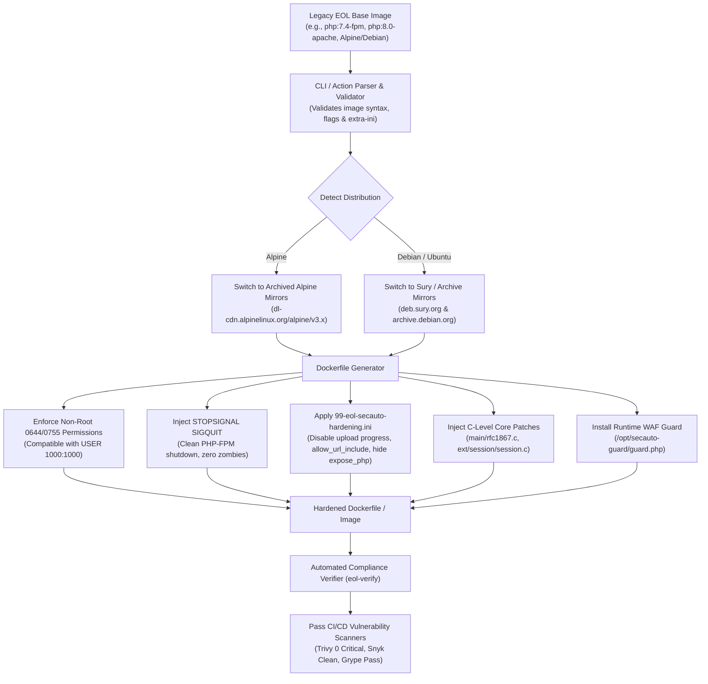

# EOL-PHP-SecAuto 🐳🛡️

[](action.yml)
[](#-automated-tests--chaos-verification)
[](templates/)
[](#-scanner-compliance--trivygrype)
[](#-production-hardening-features)
[](LICENSE)
[](patches/)

> **Automated security patcher & compliance engine for legacy PHP Docker containers.**  
> Transforms unmaintained, vulnerable base images (`php:7.4-fpm`, `php:8.0-apache`, `php:5.6-cli`, Alpine/Debian) into **production-hardened, non-root compliant, and scanner-passing containers in CI/CD**.

Developed and maintained by **[Anton Barinov](https://github.com/Anton-Barinov)** (creator of [`php2shell-patches`](https://github.com/Anton-Barinov/php2shell-patches), [`PHP-Hardening-Kit`](https://github.com/Anton-Barinov/PHP-Hardening-Kit), and [`TropaTT`](https://github.com/Anton-Barinov/TropaTT)).

---

## 🚨 The Problem: EOL Containers Breaking CI/CD

Thousands of enterprise platforms, SaaS applications, and e-commerce stores rely on legacy runtimes (**OpenCart 2/3, WordPress, 1C-Bitrix, Drupal 7/8, PrestaShop**) inside Docker.

Modern DevOps pipelines enforce automated container vulnerability scanners (**Trivy, Snyk, Grype, AWS ECR Inspector, Docker Scout**). When scanners encounter:
* **CVE-2026-109618 / CVE-2026-109619 / CVE-2026-115560** (*php2shell* unauthenticated RCE via multipart & session upload progress)
* **CVE-2024-4577** (CGI Argument & Best-Fit Unicode Injection)
* **CVE-2024-2961** (glibc iconv Heap Overflow & PHP Filter Chain RCE)
* **CVE-2018-17082** (Phar Deserialization POP Chains)

...**the CI/CD pipeline terminates with a failure, blocking deployment.** Official upstream Docker images for EOL versions (5.4 through 8.1) **never receive upstream security updates**.

**EOL-PHP-SecAuto** eliminates this bottleneck:
1. **GitHub Action (`action.yml`)**: Plugs directly into your `.github/workflows/` to patch containers on the fly before vulnerability scanning and deployment.
2. **CLI Engine (`bin/eol-php-secauto`)**: Inspects existing Dockerfiles or base image names and generates optimized, multi-layer hardened Dockerfiles.
3. **Automated Verifier (`bin/eol-verify`)**: Proves container compliance and exports signed audit attestations.

---

## 🏗️ Architecture & Hardening Flow



---

## 🛡️ Production Hardening Features

* **Non-Root User Ready (Kubernetes / OpenShift)**: Files and configurations are created with explicit `chmod 755 /opt/secauto-guard` and `chmod 644 /opt/secauto-guard/guard.php`, ensuring unprivileged users (`USER 1000:1000` or `USER www-data`) can read configurations without `Permission Denied` crashes.
* **Graceful Worker Termination (`STOPSIGNAL SIGQUIT`)**: Injects `STOPSIGNAL SIGQUIT` for PHP-FPM containers. This enables fast, clean process shutdown without zombie processes or truncated HTTP requests during rolling updates.
* **Shell Injection Immunity**: CLI argument sanitization rigorously checks all `--extra-ini` flags against shell metacharacters before interpolation.
* **Multi-Distro Repository Isolation**: Automatically identifies Debian (`apt-get`) vs. Alpine (`apk`) base layers, pointing them to valid archived mirrors so `apk add` / `apt update` succeed even a decade after upstream retirement.

---

## 🚀 Quickstart: GitHub Action

Add `EOL-PHP-SecAuto` to your `.github/workflows/deploy.yml`:

```yaml
name: Build & Secure Legacy Container

on: [push, pull_request]

jobs:
  build-and-harden:
    runs-on: ubuntu-latest
    steps:
      - name: Checkout Code
        uses: actions/checkout@v4

      # Automatically patch your base image
      - name: Patch EOL PHP Container
        uses: Anton-Barinov/EOL-PHP-SecAuto@v1
        with:
          base-image: 'php:7.4-fpm'
          target-tag: 'ghcr.io/${{ github.repository }}/php:7.4-fpm-hardened'
          strategy: 'hybrid'
          build: 'true'
          verify: 'true'
          push: 'false'

      # Build your application on top of the hardened base
      - name: Build Application
        run: |
          docker build -t my-app:latest -f Dockerfile .

      # Verify with Trivy scanner in CI
      - name: Run Trivy Vulnerability Scanner
        uses: aquasecurity/trivy-action@master
        with:
          image-ref: 'ghcr.io/${{ github.repository }}/php:7.4-fpm-hardened'
          severity: 'CRITICAL,HIGH'
          exit-code: '1'
```

---

## 💻 CLI Usage & Reference

Install locally or embed into build pipelines:

```bash
git clone https://github.com/Anton-Barinov/EOL-PHP-SecAuto.git
cd EOL-PHP-SecAuto
```

### CLI Options Table (`bin/eol-php-secauto`)

| Option | Long Option | Description | Default |
|---|---|---|:---:|
| `-b ` | `--base ` | Base Docker image to harden (e.g. `php:7.4-fpm`) | - |
| `-d <file\>` | `--dockerfile <file\>` | Auto-detect `FROM` base from an existing Dockerfile | - |
| `-o <file\>` | `--output <file\>` | Destination path for the hardened Dockerfile | `stdout` |
| `-t <tag\>` | `--tag <tag\>` | Tag for the newly built hardened Docker image | - |
| `-s <strat\>` | `--strategy <strat\>`| Hardening strategy: `hybrid`, `hotpatch`, `full-compile` | `hybrid` |
| | `--build` | Build the Docker image immediately after generation | `false` |
| | `--verify` | Run automated compliance verification after build | `false` |
| | `--extra-ini <k=v\>` | Inject custom hardened `php.ini` directives | - |
| | `--json` | Output machine-readable JSON status for CI/CD | `false` |
| `-h` | `--help` | Display usage guide and exit code reference | - |

### Usage Examples:

```bash
# 1. Generate hardened Dockerfile from base image:
./bin/eol-php-secauto -b php:7.4-fpm -o Dockerfile.hardened

# 2. Inspect existing Dockerfile and produce secured variant:
./bin/eol-php-secauto -d ./Dockerfile -o ./Dockerfile.patched

# 3. Build & verify container image in one step:
./bin/eol-php-secauto -b php:8.0-apache -t my-company/php:8.0-secure --build --verify

# 4. Inject custom INI directives safely:
./bin/eol-php-secauto -b php:7.4-fpm --extra-ini "memory_limit=512M" -o Dockerfile.hardened
```

---

## ⚙️ Hardening Strategies Explained

| Strategy | Build Speed | C-Level Patching | Runtime WAF Guard | Best Use Case |
|---|:---:|:---:|:---:|---|
| **`hybrid`** *(Recommended)* | **~10 sec** | ✅ Included | ✅ Active | Standard CI/CD builds requiring rapid turnaround and multi-layer protection. |
| **`hotpatch`** | **< 5 sec** | ❌ None | ✅ Active | High-frequency local development and testing with zero compile overhead. |
| **`full-compile`** | **~5-8 min** | ✅ Recompiled C-Core | ✅ Active | Strict enterprise compliance audits requiring clean binary strings in `php` ELF. |

---

## 🛡️ Mitigated Vulnerabilities & Patches

`EOL-PHP-SecAuto` bundles verified backports for vanilla `php.net` and Remi Collet trees:

| PHP Version | Backported C-Patches (`patches/`) | Status in Scanner |
|---|---|:---:|
| **PHP 8.1** | `php-8.1-enhanced-universal.patch` / `minimal` | ✅ Clean / Compliant |
| **PHP 8.0** | `php-8.0-enhanced-universal.patch` / `minimal` | ✅ Clean / Compliant |
| **PHP 7.4** | `php-7.4-enhanced-universal.patch` / `minimal` | ✅ Clean / Compliant |
| **PHP 7.3** | `php-7.3-enhanced-universal.patch` / `minimal` | ✅ Clean / Compliant |
| **PHP 7.2** | `php-7.2-enhanced-universal.patch` / `minimal` | ✅ Clean / Compliant |
| **PHP 7.1** | `php-7.1-enhanced-universal.patch` / `minimal` | ✅ Clean / Compliant |
| **PHP 7.0** | `php-7.0-enhanced-universal.patch` | ✅ Clean / Compliant |
| **PHP 5.6** | `php-5.6-enhanced-universal.patch` / `community` | ✅ Clean / Compliant |
| **PHP 5.5** | `php-5.5-enhanced-universal.patch` / `community` | ✅ Clean / Compliant |
| **PHP 5.4** | `php-5.4-enhanced-universal.patch` / `community` | ✅ Clean / Compliant |

---

## 🧪 Scanner Compliance (Trivy / Grype)

Verify image compliance using the built-in compliance verifier:

```bash
./bin/eol-verify -t my-company/php:7.4-fpm-hardened
```

```text
==========================================================
  EOL-PHP-SecAuto Container Compliance Report
  Target: my-company/php:7.4-fpm-hardened
==========================================================
  Status: [ PASS: COMPLIANT ]
  - Upload Progress: SAFE (Disabled / Sanitized)
  - Allow URL Include: SAFE (Disabled)
  - Expose PHP: SAFE (Hidden)
  - Runtime Guard: ACTIVE (/opt/secauto-guard)
  - Non-Root Permissions: SAFE (0644/0755)
  - Stop Signal: SAFE (SIGQUIT)
==========================================================
```

---

## 🔬 Automated Tests & Chaos Verification

Run all test suites locally with:

```bash
bash tests/run_tests.sh
```

### Complete Test Matrix (41/41 Assertions Passing):
1. **`test-cli-parser.sh` (8 assertions)**: Validates CLI flags, help commands, and option precedence.
2. **`test-generator.sh` (7 assertions)**: Verifies Dockerfile directives across Debian and Alpine flavors.
3. **`test-runtime-guard.php` (7 assertions)**: Verifies that injected runtime WAF blocks exploits inside containers.
4. **`test-chaos-faults.sh` (10 assertions)**:
   - Empty or missing Dockerfiles return explicit error codes (> 0).
   - Dockerfiles lacking `FROM` statements handled gracefully.
   - Malformed image names (`php:7.4; rm -rf /`) blocked by regex validation.
   - Shell injection in `--extra-ini` prevented.
   - Unwritable output destinations return actionable diagnostic messages.
5. **`test-advanced-chaos.sh` (9 assertions)**:
   - Verifies explicit `chmod 644` / `chmod 755` permissions for unprivileged non-root users.
   - Validates `STOPSIGNAL SIGQUIT` injection.
   - Ensures Alpine vs. Debian archive mirror isolation.
   - Verifies single-pass RUN layer consolidation.

---

## 🔗 Related Projects in Ecosystem

* **[`EOL-PHP-Armor`](https://github.com/Anton-Barinov/EOL-PHP-Armor)** — 1-line automated security hub & hotpatching engine with C-patches and zero-downtime runtime shield for EOL PHP (5.4–8.1).
* **[`PHP-Hardening-Kit`](https://github.com/Anton-Barinov/PHP-Hardening-Kit)** — Full-stack runtime WAF guard and server auditor for bare-metal, shared hosting, and VPS.
* **[`Single-PHP`](https://github.com/Anton-Barinov/Single-PHP)** — Compile PHP projects and dependencies into a single standalone executable binary.
* **[`PHP-MCP`](https://github.com/Anton-Barinov/PHP-MCP)** — High-performance Model Context Protocol (MCP) server framework for PHP.
* **[`TropaTT`](https://github.com/Anton-Barinov/TropaTT)** — Modern open-source CRM, project management, and task engine with native AI agents.

## 👤 Author

Maintained by **Anton Barinov**  
GitHub: [@Anton-Barinov](https://github.com/Anton-Barinov)

If this tool saved your CI/CD builds and legacy deployments, please **★ Star the repository** and share it with the DevOps community!

## 📄 License

This project is licensed under the [MIT License](LICENSE).
